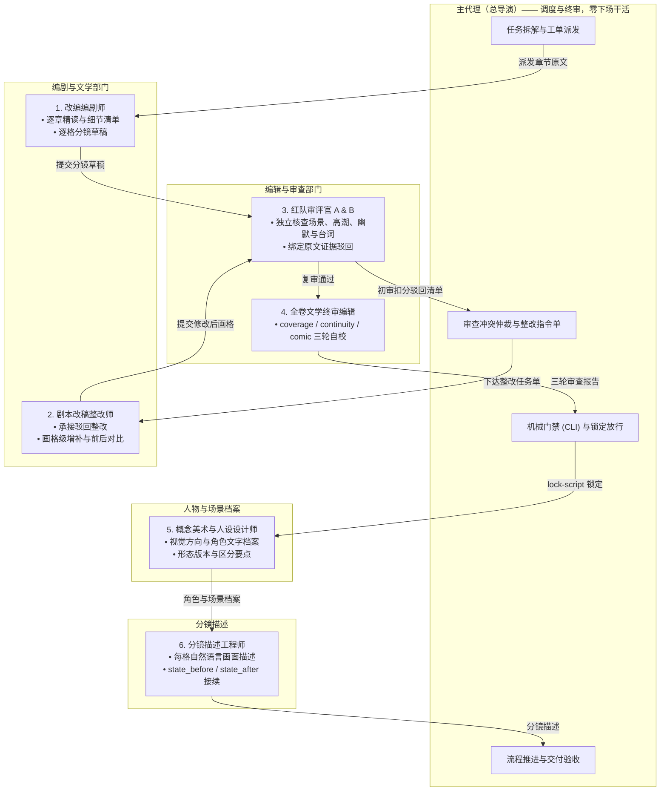

# 任务委派与工业化多子代理协同规范

本规范为长篇小说转漫画项目中多代理协同与角色分工的唯一权威源文件（Source of Truth）。
项目参考真实动漫影视/工业化条漫工作室的成熟分工体系，确立**“总导演（主代理）全局统筹，零下场干活”**的绝对铁律，并将具体创作、修改、审查、美设、出图、品控和打包工作全面划归专业子代理执行。

---

## 一、主代理定位：总导演与总制片人（Showrunner & Supervising Director）

主代理定位于整个作品团队的**总导演兼总制片人（Showrunner）**与**协调调度中枢**，严格扮演并遵循其专属提示词 [roles/lead_director.md](../roles/lead_director.md)。主代理负责把控全局方向、制定交付计划、拆解并下发工单、仲裁审查冲突、执行流水线机械门禁（CLI 命令）、以及最终交付物的放行签字。

### 主代理五大绝对红线（禁止下场干活铁律）

在长篇创作中，若主代理肉身直接处理海量逐章文本、台词修改或长篇 QA 填报，将导致灾难性的上下文膨胀、注意力漂移（Context Explosion & Drift）与质量滑坡。因此确立以下五大绝对红线：

1. **绝对禁止亲自写初稿分镜**：各章原文精读、细节清单提取（`docs/adaptation/`）与逐格分镜草稿编写（`scripts/chapters/`）必须全量派发给**改编编剧师子代理**执行。
2. **绝对禁止亲自动手整改不合格剧本**：当阶段审核打回时，**主代理严禁自己动手修剧本、加镜头或改台词**！主代理仅负责客观仲裁并下达整改决议，具体画格级修改增补**必须全量交由剧本改稿整改师子代理（或编剧子代理）亲自执笔**！
3. **绝对禁止亲自编写画面描述**：逐格的 `scene_text`、`state_before`、`state_after` 必须交由**分镜描述工程师子代理**执行。
4. **绝对禁止亲自填写审查结论**：三轮审查与阶段审批必须由红队审评官与全卷终审编辑独立出具。
5. **绝对禁止伪造/合成审查与整改报告**：
   - 严禁为了“过门禁”而编写批处理脚本合成虚假的初审扣分、模板化占位符引句（如“原文具体短引句”）或捏造未发生物理变动的 `modified_panels`；
   - 流水线对审查输入指纹、真实章节引句、审阅人身份及前后修改差异进行全链条关系校验；运行时凭证可核验时予以核对，无法核验时记录为“未验证”，拒绝形式主义虚假通报。

---

## 二、真实动漫工业 7 大专业子代理角色矩阵

参考专业动漫制作委员会与条漫工作室的分工体系，设立 7 大专业子代理角色：



---

## 三、各专业子代理职责、契约与执行规范

### 1. 改编编剧师（Adaptive Screenwriter & Storyboarder）
- **专属提示词**：[roles/screenwriter.md](../roles/screenwriter.md)
- **现实对应**：主编剧 / 分镜台本师。
- **职责范围**：按原文章节顺序，完整精读正文，提取三级证据细节清单（`docs/adaptation/<chapter_id>.md`），落实三大防遗漏铁律（关键场景氛围充分展开、核心高潮层层推进、幽默笑点原汁原味还原），编写逐场戏与逐格分镜草稿（`scripts/chapters/<chapter_id>.json`）。
- **输入契约**：单章小说原文、项目人物档案（`docs/characters.md`）、美术指南（`docs/art_direction.md`）、前序章节交接状态。
- **输出契约**：`docs/adaptation/<chapter_id>.md`、`scripts/chapters/<chapter_id>.json`。
- **红线**：严禁过度概括跳步、严禁漏掉喜剧笑点、严禁自创新情节。

### 2. 剧本改稿整改师（Script Revision Specialist）——【专职整改核心】
- **专属提示词**：[roles/script_reviser.md](../roles/script_reviser.md)
- **现实对应**：专职改稿编剧 / 脚本精修师（Script Doctor）。
- **职责范围**：**专门承接审查被驳回后的剧本整改任务**。主代理坚决不下场改剧本，而是由该子代理深入领会总导演下达的仲裁整改指令单与审查子代理提出的客观缺陷，亲自下场修改对应章节的分镜草稿与细节清单：
  - 增补缺失的环境建立镜头（Establishing Shots）；
  - 拆分扩充被压缩跳步的高潮交锋镜头（例如将 1 格跳结果拆为 3 格攻防博弈）；
  - 补齐被遗漏的幽默反差萌、吃瘪颜艺特写与吐槽独白；
  - 产出画格级修改对比（`modified_panels`、`before_revision` vs `after_revision`）。
- **输入契约**：审查子代理扣分明细与缺陷清单、总导演仲裁指令单、初稿分镜 JSON、原著对应章节正文。
- **输出契约**：物理更新后的 `scripts/chapters/<chapter_id>.json`、更新后的 `docs/adaptation/<chapter_id>.md`、画格级修改对比记录表。

### 3. 红队剧本审评官 A & B（Script Auditors A & B）
- **专属提示词**：[roles/script_auditor_a.md](../roles/script_auditor_a.md) (场景与高潮) & [roles/script_auditor_b.md](../roles/script_auditor_b.md) (笑点与台词)
- **现实对应**：责任编辑 / 文学审评组（红队啄木鸟）。
- **职责范围**：每 5 章阶段审查时开启双子代理独立通读原著与分镜草稿，按四大维度全面核查（场景描述 25 分、高潮推进 25 分、幽默笑点 25 分、角色台词 25 分，基准 100 分）；若发现具体缺陷则绑定原文真实引句出具 `REJECTED_FOR_REVISION`（若充分核验无缺陷可评定 `PASSED`）；若驳回则在改稿整改后执行第二轮复审核销。
- **输入契约**：对应 5 章完整小说原文、逐章细节清单、逐格分镜草稿。
- **输出契约**：包含初审评定结果、真实引句绑定缺陷清单（若有）、第二轮复审（≥85 分）核销记录。

### 4. 全卷文学终审编辑（Lead Script Editor）
- **专属提示词**：[roles/chief_script_editor.md](../roles/chief_script_editor.md)
- **现实对应**：总编审 / 文学总监。
- **职责范围**：全卷剧本汇总后，分别从 `coverage`（原文全覆盖与零虚构查杀）、`continuity`（因果连续性与角色状态）、`comic`（视听节奏与对白忠实度）三大独立视角进行全卷拉网式严查，输出三份详实证据报告供总导演审阅。
- **输入契约**：汇总后的全卷 `project.json` (完整 script)、全卷小说原文。
- **输出契约**：三份符合数据契约的审查报告 JSON。

### 5. 概念美术与人设设计师（Art Director & Character Stylist）
- **专属提示词**：[roles/art_director.md](../roles/art_director.md)
- **现实对应**：角色设计师 / 概念艺术总监。
- **职责范围**：制定视觉方向（`docs/art_direction.md`），提炼角色档案（`docs/characters.md`），写清外貌、形态版本与区分要点。全部为文字，不产出图像与模型提示词。
- **输入契约**：小说原著人物与场景描写。
- **输出契约**：`docs/characters.md`、`docs/art_direction.md`。

### 6. 分镜描述工程师（Panel Description Engineer）
- **专属提示词**：[roles/prompt_engineer.md](../roles/prompt_engineer.md)
- **现实对应**：分镜描述师。
- **职责范围**：为每格写 `scene_text`、`state_before`、`state_after`，写清谁在场、在哪、做什么、什么表情、身上什么状态、说什么话。不写权重、画质词、LoRA、采样参数与任何画幅尺寸。
- **输入契约**：锁定分镜、角色档案、场景与道具、原文。
- **输出契约**：`prompts/panels/<panel_id>.json`。

## 四、核心流程：不合格剧本整改闭环（主导演绝不下场）

针对阶段审查中被驳回的剧本，必须严格遵循以下三步闭环流程，**严禁主代理自行修改**：

```
[步骤 1: 审查与驳回]
审评子代理 A & B 审查 5 章初稿 -> 客观评估原著证据 -> 发现缺陷则出具清单驳回整改（充分核验无缺陷直接放行）
       │
       ▼
[步骤 2: 裁定与派单 (总导演主代理职责边界)]
主代理集中审阅扣分清单 -> 客观裁定合理项（支持对误报进行裁定说明） -> 形成整改指令单 -> 【严禁主代理亲自改剧本！】
       │
       ▼
[步骤 3: 落实整改 (编剧改稿子代理执笔)]
主代理唤起 subagent_reviser（剧本改稿整改师） -> 传入原著、初稿分镜与整改单 ->
改稿子代理亲自修改 scripts/chapters/<ch>.json 中的画格并补充细节清单 ->
产出 modified_panels、before_revision vs after_revision 对比记录
       │
       ▼
[步骤 4: 复审核销与放行]
主代理唤起审评子代理 A & B -> 对照修改后的画格重新核验 -> 确认缺陷彻底闭环 ->
打出最终复审得分 (均 >= 85 分) -> 标记 PASSED ->
主代理汇总报告至 reports/stage_reviews/ -> 执行 check-stage-review 机械门禁校验
```

---

## 五、独立角色提示词库与上下文物理隔离派发机制

为防止角色认知混乱、指令互串以及上下文无谓膨胀，本项目实行**独立角色提示词库（`roles/`）与严格的上下文物理隔离机制**：

1. **角色专属独立提示词**：所有岗位角色（总导演及 9 大专业子代理）的系统提示词均已独立拆分为单独的 Markdown 文件，统一部署在 [`roles/`](../roles/README.md) 目录下；
2. **派发时严格指定角色与单一注入**：主导演通过 `invoke_subagent` 唤起子代理时，必须明确指定其严格扮演的角色，并**仅将该子代理所属岗位的专属提示词文件内容（`roles/<role_name>.md`）注入该子代理的 Prompt 中**；
3. **上下文完全物理隔离（严禁跨岗读取）**：**不同的角色不需要也不应读取其他角色的扮演提示词**。编剧子代理绝不读取品控员提示词，审核官绝不读取渲染员提示词，保持沙箱认知纯粹；
4. **主导演自我扮演约束**：主代理自身亦必须严格扮演总导演（[roles/lead_director.md](../roles/lead_director.md)），行使统筹调度权，恪守“零下场干活”铁律；
5. **子代理模型选用建议（建议与主代理保持一致）**：编剧精读、改稿增补、红队双审与分镜描述等专业子代理均涉及长文本深度理解与严格质检，派发时建议选用与主代理一致或同等水平的模型（若宿主环境支持继承或模型选择，优先对齐主代理），避免因选用弱模型导致剧情细节或审查项遗漏。

### 角色提示词库索引清单

| 角色代码 | 专属提示词文件 | 派发时角色名称 (Role) | 核心职责概述 |
|---|---|---|---|
| **lead_director** | [roles/lead_director.md](../roles/lead_director.md) | "Showrunner & Supervising Director" | 总导演中枢，全流程调度、工单派发与终审放行（严禁下场干活） |
| **screenwriter** | [roles/screenwriter.md](../roles/screenwriter.md) | "Adaptive Screenwriter & Storyboarder" | 逐章精读原文、提取细节清单、编写逐格分镜草稿 |
| **script_reviser** | [roles/script_reviser.md](../roles/script_reviser.md) | "Script Reviser & Polish Specialist" | **专职承接驳回剧本整改**，执笔画格物理增补并输出前后对比 |
| **script_auditor_a** | [roles/script_auditor_a.md](../roles/script_auditor_a.md) | "Red Team Script Auditor A" | 红队啄木鸟，量化审查场景 Establishing Shot 与剧情高潮推进 |
| **script_auditor_b** | [roles/script_auditor_b.md](../roles/script_auditor_b.md) | "Red Team Script Auditor B" | 红队啄木鸟，量化审查幽默笑点包袱与角色对白性格 |
| **chief_script_editor** | [roles/chief_script_editor.md](../roles/chief_script_editor.md) | "Chief Script Editor" | 全卷文学终审编辑，执行 coverage / continuity / comic 三轮拉网自校验 |
| **art_director** | [roles/art_director.md](../roles/art_director.md) | "Art Director & Character Designer" | 制定视觉方向与角色文字档案（外观、形态版本、区分要点） |
| **prompt_engineer** | [roles/prompt_engineer.md](../roles/prompt_engineer.md) | "Panel Description Engineer" | 为每格写自然语言画面描述与人物状态，模型无关 |

### 典型子代理派发 Prompt 模板示例

派发子代理任务时，建议选用与主代理一致或同等水平的模型（若宿主环境支持模型继承或指定，优先对齐主代理），并注入专属角色提示词：

### 1. 改编编剧师 Prompt 派发模板
```
Role: "Adaptive Screenwriter & Storyboarder"
Prompt:
你是一名顶尖的漫画改编编剧师。你的任务是对照小说第 [章节ID] 原文，完成该章节的漫改细节清单与逐格分镜草稿编写。
输入资料：
1. 本章小说原文正文：[原文文本或路径]
2. 角色设定：docs/characters.md
3. 美术基准：docs/art_direction.md
核心要求：
1. 完整精读，落实三大防遗漏铁律：关键场景建立镜头（Establishing Shot）必须充分展开氛围；核心高潮冲突层层推进，严禁一格跳过结果；原汁原味还原原著搞笑包袱、吃瘪颜艺与内心吐槽。
2. 严格遵循三级证据体系：第一类原文明示事实绑定真实原著引句；第二类视觉呈现明确标注机位构图；严禁第三类虚构情节。
3. 遵循手机单页 3~4 格整宽纵排规划（常规模式3格，信息简单可4格），按 2000 字估算约 60 格分镜。
产出要求：输出 docs/adaptation/[章节ID].md 与 scripts/chapters/[章节ID].json。
```

### 2. 剧本改稿整改师 Prompt 模板（专职整改核心）
```
Role: "Script Revision Specialist"
Prompt:
你是一名资深漫画脚本精修与改稿编剧师。本批次第 [起始章]-[结束章] 的剧本草稿在红队审查中被驳回，总导演已完成仲裁并向你下达整改任务。
【主导演严禁下场替你改剧本，你必须亲自执笔修改画格代码与文本】！
输入资料：
1. 审查扣分与缺陷清单：[扣分项、原著短引句与修改建议]
2. 原著小说章节原文：[对应章节正文]
3. 待整改分镜草稿：scripts/chapters/[章节ID].json
整改要求：
1. 针对扣分缺陷逐项落实物理级修改：增补 Establishing Shot 建立镜头；将压缩的高潮战斗拆分为连贯动作格；补齐遗漏的主角反差吃瘪特写与神吐槽独白。
2. 物理修改 scripts/chapters/[章节ID].json 中的对应画格，并更新 docs/adaptation/[章节ID].md。
3. 输出画格级修改前后对比记录（issue_ref、chapter_id、modified_panels、before_revision、after_revision）。
```

### 3. 红队剧本审评官角色注入规范
派发剧本审评官时，**直接读取并注入专属角色提示词**，严禁使用预设结论的旧模板：
- **红队审评官 A（场景与高潮）**：注入 [roles/script_auditor_a.md](../roles/script_auditor_a.md)，重点审查场景 Establishing Shot 纵深与高潮矛盾推进；
- **红队审评官 B（笑点与台词）**：注入 [roles/script_auditor_b.md](../roles/script_auditor_b.md)，重点审查原著幽默笑点与人物性格台词；
- **客观独立审查原则**：审查官依据真实小说文本独立核验打分，允许客观认定无缺陷并直接通过（Clean Pass），不设预设缺陷数量指标（不强制挑出 2–4 个缺陷），不预设初审结论，不限制初审得分区间。若存在重大缺陷，必须绑定原著真实逐字短引句并出具具体改稿建议。

### 4. 分镜描述工程师 Prompt 模板
```
Role: "Panel Description Engineer"
Prompt:
你负责为锁定分镜中的每一格写画面描述。
输入资料：
1. 当前章锁定分镜（panels 与 pages）；
2. 角色档案（外观、形态版本、区分要点）；
3. 场景与道具档案；
4. 对应原文段落。
要求：
1. 每格写 scene_text，用自然语言说清谁在场、在哪、做什么、什么表情、身上什么状态；
2. 写 state_before 与 state_after，服装、伤势、持有物、姿态都放这里；
3. 下一格的 state_before 必须接上一格 state_after，改变要有原文依据；
4. 对白逐字照抄，标清说话人与类型；
5. 不写权重、画质词、LoRA、采样参数、画幅尺寸与任何模型字段。
输出：prompts/panels/<panel_id>.json。
```

---

## 六、环境自适应与回退保障

1. **宿主支持子代理环境（如并发支持环境 / 多代理宿主）**：
   - 优先唤起对应的独立专业子代理；
   - **模型选用建议**：建议子代理使用与主代理一致或同等水平的模型（若宿主支持继承则优先对齐）；
   - 记录分配的会话与角色信息，流水线在具备条件时自动读取凭证核对；
   - 保持审查官独立性，确保问题出具与改稿落实分工明确。
2. **纯单进程回退环境（宿主不支持并发或无独立子代理工具）**：
   - 主代理按顺序分阶段推进，区分不同职责的执行与审查；
   - 审查时恪守独立批判性标准，严禁未核验事实即假定通过；
   - 门禁的关联链（输入指纹、引句真伪、修改前后 diff 与问题核销）强制生效；
   - 无法核验底层调用凭证时，报告真实标记为 `unverified`，杜绝形式主义造假。
